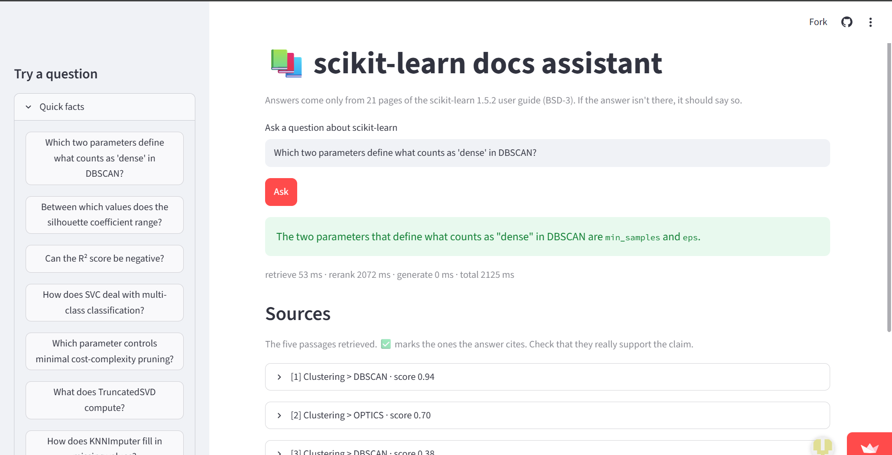
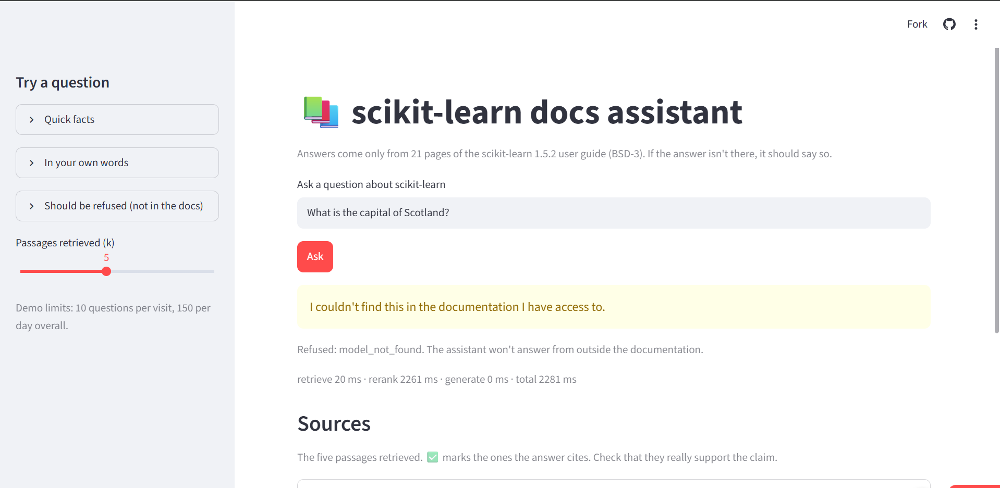

# Domain RAG assistant with a proper evaluation harness

A question-answering assistant over 21 pages of the **scikit-learn 1.5.2 user guide**, built around the part most RAG demos skip: measuring it. Retrieval is scored with Recall@k and MRR, answers with key-fact recall and citation checks, and the system is tested on questions its documents *cannot* answer.

**Live demo:** `<add your Streamlit URL here after deploying>` (rate-limited, runs on free tiers, may sleep. Questions are processed by a third-party LLM API, Gemini free tier.)

## About

Most "chat with your documents" projects stop at a demo. This one is built to be measured. It answers scikit-learn questions using only 21 pages of the official user guide, cites the passages it used, and is expected to say "not found" when the documentation doesn't contain the answer.

Retrieval combines BGE embeddings (FAISS) with BM25 and a cross-encoder reranker; an LLM then writes a cited answer from the top five passages. The evaluation harness scores retrieval (Recall@k, MRR, with ablations over chunk size, reranking and hybrid search), answer quality (key facts and citations) and refusal behaviour on 14 unanswerable questions, with a dev/test split and a leakage guard.

## Screenshots

| An answered question, with cited sources | A refusal on a question the docs can't answer |
|---|---|
|  |  |

## Headline results

All numbers are on 76 hand-written questions (62 answerable, 14 unanswerable); details and caveats below.

- **Reranking helped every retrieval configuration.** MRR@10 rose in all 9 matched pairs (chunk size x retrieval mode), e.g. 0.757 to 0.842 for dense retrieval at 150-token chunks. Cost: roughly 1.0-1.6 s per query on CPU versus about 15-80 ms without it.
- **Once you rerank, the retrieval mode barely matters.** At 150 tokens, dense, BM25 and hybrid are identical (MRR 0.842).
- **Smaller chunks reach the same recall with far less context.** Recall@5 is about 0.94 at every size, but the generator receives about 425 words at 150 tokens versus about 1,200 at 500.
- **The LLM refused all 14 unanswerable questions by itself.** A retrieval-score gate (AUROC 0.93) added nothing on unanswerables and wrongly refused 29% of answerable test questions, so it is off by default.
- **Answers are mostly right but not always well cited.** Key-fact recall is about 0.91 on both splits; citation precision is 0.69 on the test split.

## How it works

```
question -> retrieve top 30 (dense BGE + BM25, fused) -> cross-encoder rerank -> top 5
         -> LLM answers from those 5 passages with [n] citations, or says NOT_FOUND
```

| Step | Implementation |
|---|---|
| Ingest | `src/ragkit/corpus.py` parses reStructuredText headings into heading paths and strips Sphinx markup |
| Chunk | `chunking.py`: paragraph packing, 15% overlap, size in approximate tokens (1 word is about 1.33 tokens); the heading path is kept as metadata and prepended for embedding |
| Embed and index | `BAAI/bge-small-en-v1.5`, exact FAISS inner-product index |
| Retrieve | dense, BM25 (own implementation) or hybrid via reciprocal rank fusion; 30 candidates |
| Rerank | cross-encoder `cross-encoder/ms-marco-MiniLM-L-6-v2` |
| Generate | any OpenAI-compatible endpoint (used here: Gemini via Google's compatibility API); numbered passages, mandatory `[n]` citations, `NOT_FOUND` escape hatch; citations are parsed and validated |
| Refusal | optional retrieval gate (threshold calibrated on dev, reported on test) |
| Serve | Streamlit app (in-process) for the demo; FastAPI service (`/ask`, `/health`, `/stats`) with per-request latency logs; Dockerfile and compose file |

## Evaluation design

- **76 questions:** 62 answerable, 14 unanswerable, split alternately into dev and test. Unanswerable ones are out-of-domain ("capital of Scotland"), adjacent-ecosystem (XGBoost, SHAP, BayesSearchCV) or plausible-but-absent (Random Survival Forest). `eval/validate_questions.py` checks the distinctive terms really are absent from the corpus.
- **Labels are evidence phrases inside a gold document, not chunk ids.** A chunk is relevant if it comes from the gold document and contains a gold phrase, so labels stay valid across the chunk-size ablation. The validator proves every phrase lands inside one chunk at 150/300/400/500 tokens.
- **Retrieval metrics:** Recall@k (a gold chunk is in the top k), MRR@10, bootstrap 95% CI on Recall@5.
- **Answer metrics:** key-fact recall (substring match on expected facts), citation hit (any cited chunk is gold) and citation precision (share of cited chunks that are gold).
- **Refusal:** a retrieval-score gate with its threshold chosen on the dev split only and reported on test, compared against the LLM's own refusals.
- **Leakage guard:** a test fails if any eval question or evidence phrase appears in the prompt template or library source. The prompt is a fixed template with no few-shot examples.
- **Judge:** an LLM-judge for faithfulness and relevance is implemented (`eval/judge.py`, `eval/calibrate_judge.py`) but **its scores are not reported**: the judge (the same small model that wrote the answers) returned a perfect 2.0 on everything, which is uninformative, and it has not been calibrated against human labels.

All questions were authored against the 1.5.2 text in a single pass, and every evidence phrase is machine-verified. `eval/synthesize_questions.py` can generate synthetic candidates for spot-checking; none are included.

## Results

### Retrieval ablation (62 answerable questions)

Embedder `BAAI/bge-small-en-v1.5`; reranker `cross-encoder/ms-marco-MiniLM-L-6-v2`. Recall@k = a gold chunk is in the top k. Ctx words@5 = words handed to the generator.

| Chunk (tok) | Retrieval | Rerank | R@1 | R@3 | R@5 [95% CI] | R@10 | MRR@10 | Ctx words@5 | ms/q |
|---|---|---|---|---|---|---|---|---|---|
| 150 | dense | no | 0.66 | 0.82 | 0.89 [0.81-0.95] | 0.97 | 0.757 | 424 | 14 |
| 150 | bm25 | no | 0.56 | 0.85 | 0.92 [0.85-0.98] | 0.95 | 0.713 | 417 | 15 |
| 150 | hybrid | no | 0.66 | 0.94 | 0.94 [0.87-0.98] | 0.98 | 0.802 | 415 | 14 |
| 150 | dense | yes | 0.77 | 0.90 | 0.94 [0.87-0.98] | 0.98 | 0.842 | 424 | 1155 |
| 150 | bm25 | yes | 0.77 | 0.90 | 0.94 [0.87-0.98] | 0.98 | 0.842 | 427 | 956 |
| 150 | hybrid | yes | 0.77 | 0.90 | 0.94 [0.87-0.98] | 0.98 | 0.842 | 426 | 986 |
| 300 | dense | no | 0.60 | 0.79 | 0.87 [0.79-0.95] | 0.94 | 0.715 | 812 | 21 |
| 300 | bm25 | no | 0.66 | 0.87 | 0.94 [0.87-0.98] | 0.97 | 0.776 | 824 | 22 |
| 300 | hybrid | no | 0.65 | 0.90 | 0.92 [0.84-0.98] | 0.95 | 0.770 | 821 | 77 |
| 300 | dense | yes | 0.71 | 0.90 | 0.94 [0.87-0.98] | 0.94 | 0.802 | 849 | 1393 |
| 300 | bm25 | yes | 0.71 | 0.92 | 0.95 [0.89-1.00] | 0.97 | 0.810 | 851 | 1608 |
| 300 | hybrid | yes | 0.71 | 0.90 | 0.95 [0.89-1.00] | 0.95 | 0.805 | 845 | 1364 |
| 500 | dense | no | 0.61 | 0.82 | 0.84 [0.74-0.92] | 0.92 | 0.723 | 1175 | 15 |
| 500 | bm25 | no | 0.73 | 0.92 | 0.92 [0.85-0.98] | 0.97 | 0.821 | 1177 | 15 |
| 500 | hybrid | no | 0.65 | 0.90 | 0.94 [0.87-0.98] | 0.95 | 0.775 | 1157 | 15 |
| 500 | dense | yes | 0.77 | 0.90 | 0.92 [0.84-0.98] | 0.95 | 0.836 | 1232 | 1581 |
| 500 | bm25 | yes | 0.77 | 0.94 | 0.94 [0.87-0.98] | 0.97 | 0.845 | 1266 | 1353 |
| 500 | hybrid | yes | 0.77 | 0.92 | 0.94 [0.87-0.98] | 0.97 | 0.841 | 1244 | 1361 |

What the table supports:
- **Reranking:** MRR improves in all 9 pairs; the gain is largest for dense retrieval (+0.08 to +0.11) and smallest for BM25 at 300 and 500 tokens (+0.02 to +0.03).
- **Without reranking,** dense is the weakest mode. Hybrid is best only at 150 tokens; BM25 is best at 300 and 500.
- **Chunk size:** no clear accuracy trend (differences are inside the confidence intervals), but context length differs about 3x.
- **Not supported:** claims about small differences. Recall@5 intervals overlap almost everywhere.

### End-to-end (hybrid, 400-token chunks, k = 5)

Generator and judge model: Gemini 3.5 Flash-Lite via the OpenAI-compatible API. Test split: 31 answerable and 7 unanswerable questions.

| Test split | No gate | Gate (threshold from dev) |
|---|---|---|
| Unanswerable questions refused | 7 / 7 | 7 / 7 |
| Answerable questions wrongly refused | 0% | 29% |
| Key-fact recall (answered questions) | 0.914 | 0.924 |
| Citation hit | 0.774 | 0.773 |
| Citation precision | 0.688 | 0.674 |

Dev split (no gate): key-fact recall 0.903, citation hit 0.903, citation precision 0.801, 7 / 7 unanswerable refused.

### Refusal gate

The reranker's top score separates answerable from unanswerable questions well (AUROC 0.93, threshold 0.972 chosen on dev), but the threshold also rejects answerable questions (19% on dev, 29% on test). Since the LLM already refused all unanswerable questions, the gate is a net loss here and stays off.

Pooling dev and test (no tuning is involved without the gate), the LLM refused 14 / 14 unanswerable questions. With only 14 questions, the 95% lower bound for its true refusal rate is about 77%, so this is encouraging but not proof.

## Limitations

- **Small, easy question set.** Most questions are single-fact lookups that reuse the documentation's own terminology (`min_samples`, `ccp_alpha`), which flatters keyword search and pushes retrieval toward the ceiling. Recall@5 intervals are about +/-8 points. The unanswerable questions are mostly obvious; a hard version (real scikit-learn topics outside the 21 loaded pages) is not yet tested.
- **One author.** All questions were written by one person, with one style and set of blind spots.
- **Judge not usable.** See above; faithfulness and relevance are not reported.
- **Citation metrics are strict.** A cited chunk counts as wrong unless it contains the gold phrase, so a different passage that also supports the answer is penalised. It has not been measured how often the model omits citations altogether.
- **Key-fact recall is a substring match,** so correct paraphrases can be missed and lucky matches counted.
- **Config mismatch.** The ablation covers 150/300/500-token chunks; the end-to-end run used 400 tokens.
- **Latency is only meaningful in the ablation table.** End-to-end run latencies include a deliberate request throttle and cached LLM replies. The heavier `bge-reranker-base` was far too slow on the CPU used (roughly 15-20 minutes per reranked configuration), which is why the sweep uses MiniLM-L6. The hosted demo runs on a shared free-tier CPU and is slower (about 3 s per question observed, mostly reranking).
- **Single corpus and domain.** 21 pages of one library's documentation.

## Reproduce (Windows PowerShell; use `export` instead of `$env:` on macOS/Linux)

```powershell
python -m venv .venv
.venv\Scripts\Activate.ps1
pip install -r requirements-dev.txt
python scripts/fetch_corpus.py            # downloads scikit-learn 1.5.2 docs (BSD-3)
pytest -q                                 # 18 tests, offline

$env:PYTHONPATH = ".;src"
python eval/validate_questions.py
python eval/run_ablations.py --reranker cross-encoder/ms-marco-MiniLM-L-6-v2 --sizes 150 300 500 --tag real
python eval/refusal_eval.py --reranker cross-encoder/ms-marco-MiniLM-L-6-v2

# end-to-end needs an OpenAI-compatible endpoint, e.g. Gemini's free tier
$env:RAG_OPENAI_BASE_URL = "https://generativelanguage.googleapis.com/v1beta/openai"
$env:RAG_OPENAI_API_KEY  = "<your key>"
$env:RAG_MIN_INTERVAL_S  = "6"
python -m eval.run_e2e --tag e2e --reranker cross-encoder/ms-marco-MiniLM-L-6-v2 --generator openai:<model> --judge openai:<model>
```

Run the app locally: copy `.streamlit/secrets.toml.example` to `.streamlit/secrets.toml`, fill in your key, then `streamlit run app/streamlit_app.py`. Offline smoke test with no downloads or keys: `python eval/run_ablations.py --offline`.

## Repo layout

```
src/ragkit/    ingest, chunking, retrieval, rerankers, generation, pipeline, FastAPI service
eval/          questions, metrics, ablations, refusal analysis, end-to-end runner, judge, validators
app/           Streamlit demo
results/       summary results (per-question outputs are git-ignored)
tests/         18 tests (chunking, metrics, leakage guard, API, OpenAI-compatible backend)
```

## Licensing

Corpus: scikit-learn 1.5.2 user guide, BSD-3-Clause. The text is **not committed**; `scripts/fetch_corpus.py` downloads it and saves the licence next to it. If you redistribute chunks or built indexes, include `data/raw/LICENSE-scikit-learn.txt`. Code in this repository is yours to license; add a `LICENSE` file.
